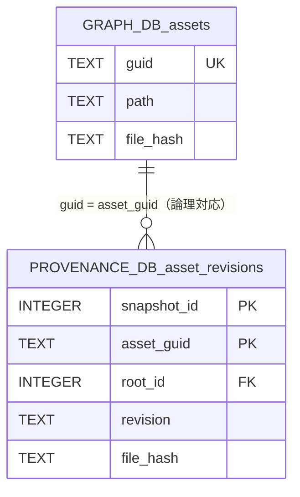

# データベース定義

GuidGraph が使う SQLite データベースの定義です。ユーザー向けの説明は `docs/manual/schema.md` にあります。ここでは、実装（`src/Graph/GraphDatabase.cs`）と、[../new-features.md](../new-features.md) で提案している追加分をまとめます。

- **現行**: 実装済みです。
- **提案**: 未実装です。実装時に定義を変える可能性があります。

| データベース | 状態 | 役割 | 定義 |
|---|---|---|---|
| graph.db | 現行（`placements` のみ提案） | プロジェクトの依存グラフ | [graph-db.md](graph-db.md) |
| provenance.db | 提案 | VCS ルートごとの識別情報（鮮度の判定用） | [provenance-db.md](provenance-db.md) |

## データベース間の関係

- graph.db と provenance.db は、アセットの GUID だけで結びつきます。ファイルのパスは使いません。
- provenance.db は graph.db と同じプロジェクト用フォルダーに置きます。VCS ルート（複数のリモート、サブモジュール、一部だけ別の VCS など）は、provenance.db の中でルートごとに持ちます。
- 外部キー制約は張れないので、対応はアプリケーション側で確認します。

## 更新と互換性のまとめ

| 変更 | 影響 |
|---|---|
| `placements` の追加（graph.db） | `SchemaVersion` 3 → 4。古い db は次の `analyze` で全再構築 |
| provenance.db の追加 | graph.db への影響なし。無ければ更新時刻で判定する |
