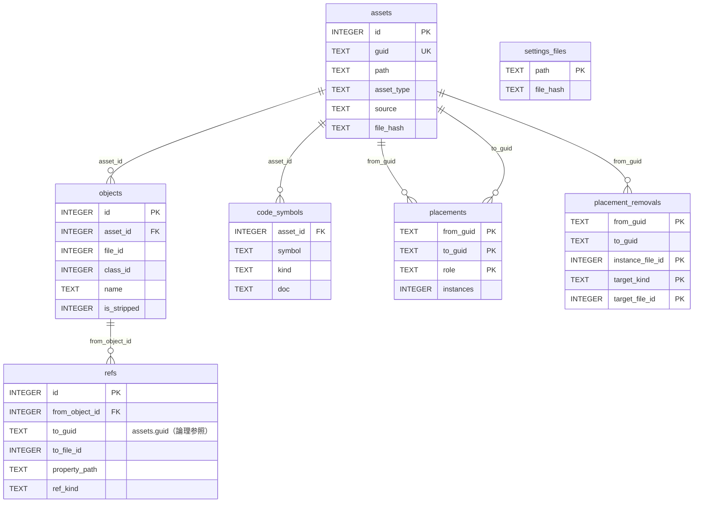

# graph.db

プロジェクトの依存グラフです。`analyze` が作り、`serve` / `export` / `report` / `search` が読み取り専用で開きます。

`PRAGMA user_version` が実装のバージョンと違う db は、増分更新せずに全再構築します。つまりスキーマ変更の影響は「次の `analyze` で作り直し」で済みますが、増分更新が全再構築と行単位で一致することを保つ必要があります。

## リレーション図

- `refs.to_guid` は `assets.guid` を指しますが、外部キー制約は付けていません（NULL は同一ファイル内の参照）。未解決の GUID も `assets` に行を持つため、参照先は必ず見つかります。
- `placements`は、`from_guid` と `to_guid` のどちらも `assets.guid` を指します。`placement_removals`は、`from_guid` と `to_guid` が `assets.guid` を指し、`target_file_id` は元の prefab の `objects.file_id` を指します。
- `settings_files` は他のテーブルと関係を持たず、変更検出にだけ使います。
- ビュー `asset_edges` は `refs` / `objects` / `assets` を結合して集約し、`unresolved_guids` は `assets` から導きます。

## 一覧

| 名前 | 種類 | 状態 | 概要 |
|---|---|---|---|
| `assets` | テーブル | 現行 | アセット（GUID 単位）。未解決 GUID も含む |
| `objects` | テーブル | 現行 | YAML ドキュメント（fileID 単位） |
| `refs` | テーブル | 現行 | 参照（1 参照 = 1 行） |
| `code_symbols` | テーブル | 現行 | C# の宣言とドキュメントコメント |
| `settings_files` | テーブル | 現行 | 走査した ProjectSettings の変更検出用 |
| `asset_edges` | ビュー | 現行 | アセット単位に集約した参照 |
| `unresolved_guids` | ビュー | 現行 | 未解決の GUID |
| `placements` | テーブル | 現行（v4） | アセットの配置数・使用数（N-8） |
| `placement_removals` | テーブル | 現行（v4） | PrefabInstance が取り除いたものの記録（N-8） |

## `assets`

| 列 | 型 | 制約 | 説明 |
|---|---|---|---|
| `id` | INTEGER | 主キー | |
| `guid` | TEXT | 一意、非 NULL | アセットの GUID |
| `path` | TEXT | | プロジェクト相対パス。未解決 GUID は NULL |
| `asset_type` | TEXT | 非 NULL | `Scene` / `Prefab` / `Script` / `ScriptableObject` / `Material` など |
| `source` | TEXT | 非 NULL | `Assets` / `Packages` / `PackageCache` / `ProjectSettings` / `BuiltIn` / `Unresolved` |
| `file_hash` | TEXT | | 変更検出用。`Unresolved` / `BuiltIn` / `ProjectSettings` は NULL |

## `objects`

| 列 | 型 | 制約 | 説明 |
|---|---|---|---|
| `id` | INTEGER | 主キー | |
| `asset_id` | INTEGER | 非 NULL、`assets(id)` | |
| `file_id` | INTEGER | 非 NULL | YAML の `&<fileID>` |
| `class_id` | INTEGER | 非 NULL | Unity のクラス ID（`!u!114` の 114 など） |
| `name` | TEXT | | `m_Name`（あれば） |
| `is_stripped` | INTEGER | 既定 0 | `stripped` サフィックス付きなら 1 |

一意制約: `(asset_id, file_id)`。インデックス: `idx_objects_asset(asset_id)`。

## `refs`

| 列 | 型 | 制約 | 説明 |
|---|---|---|---|
| `id` | INTEGER | 主キー | |
| `from_object_id` | INTEGER | 非 NULL、`objects(id)` | 参照元のオブジェクト |
| `to_guid` | TEXT | | 外部参照の GUID。NULL は同一ファイル内の参照 |
| `to_file_id` | INTEGER | 非 NULL | 参照先の fileID |
| `property_path` | TEXT | 非 NULL | `m_Script`、`m_Materials[0]`、`m_Modifications[3].target` など |
| `ref_kind` | TEXT | 非 NULL | `uses_script` / `source_prefab` / `prefab_instance` / `generic` など（一覧は `docs/manual/schema.md`） |

インデックス: `idx_refs_from_object(from_object_id)`、`idx_refs_to_guid(to_guid)`。

## `code_symbols`

| 列 | 型 | 制約 | 説明 |
|---|---|---|---|
| `asset_id` | INTEGER | 非 NULL、`assets(id)` | `.cs` のアセット |
| `symbol` | TEXT | 非 NULL | `Namespace.Type` または `Namespace.Type.Member` |
| `kind` | TEXT | 非 NULL | `class` / `struct` / `interface` / `enum` / `record` / `delegate` / `method` / `property` / `field` など |
| `doc` | TEXT | | XML doc コメント（`
` と `<remarks>`）の平文。無ければ NULL |

インデックス: `idx_code_symbols_asset(asset_id)`。スキーマ v3 で追加されました。

## `settings_files`

| 列 | 型 | 制約 | 説明 |
|---|---|---|---|
| `path` | TEXT | 主キー | 走査した `ProjectSettings/*.asset` |
| `file_hash` | TEXT | 非 NULL | 変更検出用 |

参照を持たないファイルは `assets` に行ができないため、変更検出のためにこのテーブルで持ちます。

## ビュー

**`asset_edges`**: アセット単位に集約した参照です。jsonl の出力と、`find_references` などの逆依存の問い合わせに使います。

| 列 | 説明 |
|---|---|
| `from_guid` | 参照元アセットの GUID |
| `to_guid` | 参照先の GUID（`to_guid` が NULL の同一ファイル参照は含まない） |
| `ref_kind` | 参照種別 |
| `ref_count` | 該当する `refs` の行数 |

**`unresolved_guids`**: `assets` のうち `path` が NULL の行の `guid` です。

## `placements`

N-8 `expanded_count` 用です。prefab に限らず、あらゆるアセット（prefab、マテリアル、メッシュ、スクリプトなど）について、「A が B を直接使っている数」を 1 行で持ちます。入れ子の乗算は保存せず、呼び出し時に計算します。

| 列 | 型 | 制約 | 説明 |
|---|---|---|---|
| `from_guid` | TEXT | 非 NULL | 使う側（シーン、prefab、ScriptableObject など）の GUID |
| `to_guid` | TEXT | 非 NULL | 使われる側のアセットの GUID（種別は問わない） |
| `role` | TEXT | 非 NULL | `contain`: 入れ子にして配置している（PrefabInstance）。`use`: 参照して使っている（コンポーネントのフィールド、マテリアルなど） |
| `instances` | INTEGER | 非 NULL | `from` の中で `to` を直接使っているオブジェクトの数（重複なし） |

主キー: `(from_guid, to_guid, role)`。インデックス: `idx_placements_to(to_guid)`（逆方向のたどり用）。

- `contain` の数は、`from` の中にある PrefabInstance（クラス ID 1001）のうち、`m_SourcePrefab` が `to` を指すものの数です。
- `use` の数は、`from` の中で `to` を参照するオブジェクト（`refs.from_object_id`）の、重複を除いた数です。1 つのコンポーネントが同じアセットを複数のスロットで参照していても、1 と数えます（参照数は `asset_edges.ref_count` にあります）。
- 数えるのは YAML のアセットです。バイナリ資産の中身は数えません（N-9）。

## `placement_removals`

PrefabInstance が元の prefab から取り除いたものの記録です。`m_RemovedGameObjects` と `m_RemovedComponents` を、1 件ずつ持ちます。展開数から差し引くときに、取り除かれたものが数えたいアセットを使っていたかを判定するために、件数ではなく対象を保存します。

| 列 | 型 | 制約 | 説明 |
|---|---|---|---|
| `from_guid` | TEXT | 非 NULL | PrefabInstance を持つアセット（シーンまたは prefab）の GUID |
| `to_guid` | TEXT | 非 NULL | 元の prefab の GUID |
| `instance_file_id` | INTEGER | 非 NULL | PrefabInstance の fileID（`from` の中）。インスタンスごとに別の削除を持つため |
| `target_file_id` | INTEGER | 非 NULL | 取り除かれた対象の fileID（元の prefab の中） |
| `target_kind` | TEXT | 非 NULL | `object`（GameObject）または `component` |

主キー: `(from_guid, instance_file_id, target_kind, target_file_id)`。

**作り方**: `refs` / `objects` から SQL で導く集計です（`GraphWriter.RebuildPlacements`）。`analyze` の最後に、全再構築でも増分更新でも全行を作り直します。そのため増分更新は全再構築と行単位で一致し、差分テスト（`GraphUpdaterTests.Dump`）に両テーブルを含めています。`SchemaVersion` は 4 です。

- `use` から除くもの: PrefabInstance 自身の記録（`m_SourcePrefab`、`m_Modifications[*].target`、`m_RemovedGameObjects` / `m_RemovedComponents`）と `corresponding_source`。`m_Modifications[*].objectReference` は、PrefabInstance オブジェクトによる使用として 1 回だけ数えます。
- `placement_removals.target_file_id` が、`to_guid` のアセットの `objects` に無いことがあります。入れ子の prefab やモデルの中のオブジェクトは、Unity が派生させた fileID を使うためです（サンプルでは大半がこれにあたります）。

関連: [データベース一覧](README.md)
