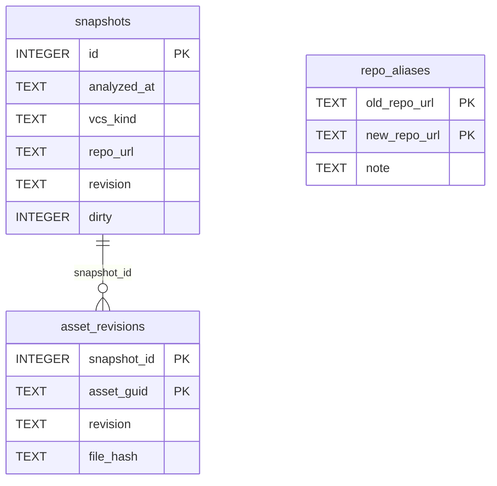

# provenance.db（提案）

N-4 の鮮度の表示用です。graph.db と同じプロジェクト用フォルダーに置きます。バージョン管理システム（VCS）の識別情報を持ち、graph.db とはアセットの GUID（`assets.guid`）だけで結びつけます。graph.db のスキーマには影響しません。

`PRAGMA user_version` は別に管理し、初版を 1 とします。

## リレーション図

- `repo_aliases` は他のテーブルと外部キーで結ばず、判定時に `snapshots.repo_url` を読み替えるときだけ使います。
- `asset_revisions.asset_guid` は graph.db の `assets.guid` に対応します（別ファイルのため外部キーではなく、論理的な対応です）。[README](README.md) の図を参照してください。

## 一覧

| 名前 | 概要 |
|---|---|
| `snapshots` | 解析ごとの VCS 識別情報 |
| `asset_revisions` | アセットごとの最終変更リビジョン |
| `repo_aliases` | リポジトリ URL の変更や VCS 移行の対応表 |

## `snapshots`

| 列 | 型 | 制約 | 説明 |
|---|---|---|---|
| `id` | INTEGER | 主キー | |
| `analyzed_at` | TEXT | 非 NULL | 解析時刻（UTC、ISO 8601） |
| `vcs_kind` | TEXT | 非 NULL | `git` / `svn` / `none` など |
| `repo_url` | TEXT | | リポジトリ URL。`none` なら NULL |
| `revision` | TEXT | | Git は SHA、Subversion はリビジョン番号。`none` なら NULL |
| `dirty` | INTEGER | 非 NULL、既定 0 | 解析時に、未コミットの変更があれば 1 |

値はすべて文字列で保存し、VCS 固有の型を持ち込みません。インデックス: `idx_snapshots_analyzed(analyzed_at)`。

## `asset_revisions`

| 列 | 型 | 制約 | 説明 |
|---|---|---|---|
| `snapshot_id` | INTEGER | 非 NULL、`snapshots(id)` | |
| `asset_guid` | TEXT | 非 NULL | アセットの GUID。パスは持たない |
| `revision` | TEXT | | そのアセットを最後に変更したリビジョン |
| `file_hash` | TEXT | | 解析時のファイルのハッシュ（graph.db の `assets.file_hash` と同じ値） |

主キー: `(snapshot_id, asset_guid)`。

## `repo_aliases`

| 列 | 型 | 制約 | 説明 |
|---|---|---|---|
| `old_repo_url` | TEXT | 非 NULL | 旧 URL |
| `new_repo_url` | TEXT | 非 NULL | 新 URL |
| `note` | TEXT | | 理由（移行、改名など） |

主キー: `(old_repo_url, new_repo_url)`。判定時に、`repo_url` をこの表で読み替えます。

関連: [データベース一覧](README.md)、[graph.db](graph-db.md)
