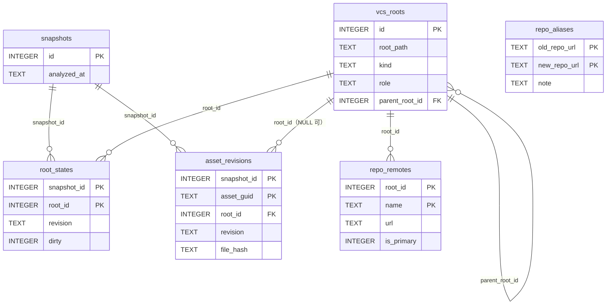

# provenance.db（提案）

N-4 の鮮度の表示用です。graph.db と同じプロジェクト用フォルダーに置きます。バージョン管理システム（VCS）の識別情報を持ち、graph.db とはアセットの GUID（`assets.guid`）だけで結びつけます。graph.db のスキーマには影響しません。

1 つのプロジェクトに VCS が複数ある状況に対応するため、識別情報は「VCS ルート」ごとに持ちます。VCS ルートは、1 つの VCS の作業コピーの最上位ディレクトリです。次のような状況を扱います。

- Git で複数のリモートを持つ
- Git のサブモジュール
- 一部のフォルダーだけ別の VCS（Subversion など）にしている
- `svn:externals`
- どの VCS の管理下にもないフォルダー

検出と判定の規則は [new-features.md](../new-features.md) の N-4 を参照してください。

`PRAGMA user_version` は別に管理し、初版を 1 とします。

## リレーション図

- `repo_aliases` は他のテーブルと外部キーで結ばず、判定時にリモートの URL を読み替えるときだけ使います。
- `asset_revisions.asset_guid` は graph.db の `assets.guid` に対応します（別ファイルのため外部キーではなく、論理的な対応です）。[README](README.md) の図を参照してください。

## 一覧

| 名前 | 概要 |
|---|---|
| `snapshots` | 解析ごとの記録 |
| `vcs_roots` | VCS ルート（プロジェクトに複数あってよい） |
| `repo_remotes` | ルートごとのリモート |
| `root_states` | 解析時の、ルートごとのリビジョンと未コミットの有無 |
| `asset_revisions` | アセットごとの最終変更リビジョン |
| `repo_aliases` | リポジトリ URL の変更や VCS 移行の対応表 |

## `snapshots`

| 列 | 型 | 制約 | 説明 |
|---|---|---|---|
| `id` | INTEGER | 主キー | |
| `analyzed_at` | TEXT | 非 NULL | 解析時刻（UTC、ISO 8601） |

インデックス: `idx_snapshots_analyzed(analyzed_at)`。

## `vcs_roots`

| 列 | 型 | 制約 | 説明 |
|---|---|---|---|
| `id` | INTEGER | 主キー | |
| `root_path` | TEXT | 非 NULL | プロジェクトのルートからの相対パス。プロジェクトのルート自身は `.`、外側のリポジトリは `..` など |
| `kind` | TEXT | 非 NULL | `git` / `svn` など |
| `role` | TEXT | 非 NULL | `main`（通常のルート）/ `submodule` / `external` / `nested` |
| `parent_root_id` | INTEGER | `vcs_roots(id)` | サブモジュールや外部参照の親のルート。なければ NULL |

一意制約: `(kind, root_path)`。

## `repo_remotes`

| 列 | 型 | 制約 | 説明 |
|---|---|---|---|
| `root_id` | INTEGER | 非 NULL、`vcs_roots(id)` | |
| `name` | TEXT | 非 NULL | Git のリモート名（`origin` など）。Subversion は `svn` |
| `url` | TEXT | 非 NULL | リモートの URL |
| `is_primary` | INTEGER | 非 NULL、既定 0 | 主のリモートなら 1。アップストリームのリモート、なければ `origin` |

主キー: `(root_id, name)`。インデックス: `idx_repo_remotes_url(url)`（照合用）。

## `root_states`

| 列 | 型 | 制約 | 説明 |
|---|---|---|---|
| `snapshot_id` | INTEGER | 非 NULL、`snapshots(id)` | |
| `root_id` | INTEGER | 非 NULL、`vcs_roots(id)` | |
| `revision` | TEXT | | Git は SHA、Subversion はリビジョン番号 |
| `dirty` | INTEGER | 非 NULL、既定 0 | 解析時に、未コミットの変更があれば 1 |

主キー: `(snapshot_id, root_id)`。値はすべて文字列で保存し、VCS 固有の型を持ち込みません。

## `asset_revisions`

| 列 | 型 | 制約 | 説明 |
|---|---|---|---|
| `snapshot_id` | INTEGER | 非 NULL、`snapshots(id)` | |
| `asset_guid` | TEXT | 非 NULL | アセットの GUID。パスは持たない |
| `root_id` | INTEGER | `vcs_roots(id)` | そのアセットが属するルート。VCS の管理下にないアセットは NULL |
| `revision` | TEXT | | そのアセットを最後に変更したリビジョン |
| `file_hash` | TEXT | | 解析時のファイルのハッシュ（graph.db の `assets.file_hash` と同じ値） |

主キー: `(snapshot_id, asset_guid)`。

## `repo_aliases`

| 列 | 型 | 制約 | 説明 |
|---|---|---|---|
| `old_repo_url` | TEXT | 非 NULL | 旧 URL |
| `new_repo_url` | TEXT | 非 NULL | 新 URL |
| `note` | TEXT | | 理由（移行、改名など） |

主キー: `(old_repo_url, new_repo_url)`。判定時に、リモートの URL をこの表で読み替えます。

関連: [データベース一覧](README.md)、[graph.db](graph-db.md)
